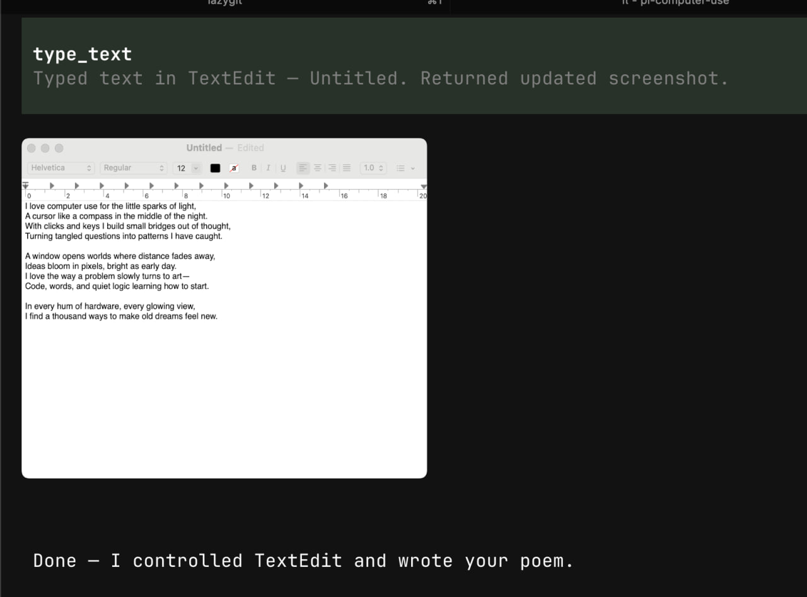

# nife-computer-use

<p align="center">
  
</p>

`nife-computer-use` lets AI agents use Windows desktop apps from nife.

An agent can look at a window, understand the buttons and text inside it, and perform actions like clicking, typing, scrolling, and waiting for something to change. This is useful when the agent needs to work with a normal desktop app instead of an API, a terminal command, or a file.

This package is forked from [pi-computer-use](https://github.com/injaneity/pi-computer-use) and adapted to nife. The macOS and Linux backends were removed; only the Windows backend remains.

## How it works

The extension registers eleven tools with nife. The tools do not touch the desktop directly. They call a small native helper, `windows-bridge.exe`, which speaks JSON lines over stdin/stdout and drives Windows UI Automation, window capture, and input:

```text
nife agent
  -> extension tools (find_roots, observe_ui, act_ui, ...)
  -> src/bridge.ts   state ids, refs, scheduling, result rendering
  -> src/platform/windows/backend.ts   protocol translation
  -> windows-bridge.exe   UIA tree, capture, SendInput/keyboard, outcomes
```

`observe_ui` returns an immutable observation with a `stateId` and element refs such as `@e12`. `act_ui` requires that `stateId`, performs checked input, and returns the successor state with a compact diff. Refs from an old state fail instead of silently addressing whatever is now on screen.

Inside WSL the same thing works: `process.platform` is `linux`, but nife detects WSL and starts the Windows helper through WSL interop, so the helper still runs as a Windows process in your Windows desktop session.

## What this package does

After installation, nife agents get tools for:

- finding open apps and windows
- observing what is visible in a window
- searching the visible interface for text, buttons, and controls
- inspecting parts of the interface in more detail
- clicking, typing, scrolling, and pressing UI controls
- waiting for UI changes

In short: it gives an agent a controlled way to operate Windows software.

## What this package is not

`nife-computer-use` is not a replacement for app APIs or MCP servers. If an app has a reliable direct integration, use that first.

Computer use is most helpful when the only available interface is the app on screen.

## Install

```bash
nife install npm:nife-computer-use                               # npm
nife install https://github.com/OliverMao/nife-computer-use      # git, tracks main
nife install https://github.com/OliverMao/nife-computer-use@v0.0.1  # git, pinned tag
```

Project-scoped install (writes `.nife/settings.json`, shareable with a team):

```bash
nife install -l npm:nife-computer-use
```

Try it without installing:

```bash
nife -e npm:nife-computer-use
```

Working on the package itself? `nife install /absolute/path/to/nife-computer-use` references the checkout in place instead of copying it, so edits take effect after `/reload`.

Then start nife in an unlocked interactive Windows desktop session (or inside WSL with interop enabled). Require nife `0.3.7` or newer.

The Windows helper is installed per user at `~/.nife/agent/helpers/nife-computer-use/windows-bridge.exe`. The prebuilt binary ships with the package, so no Rust toolchain is required. Override the location with `NIFE_COMPUTER_USE_WINDOWS_HELPER_PATH`.

Use `/computer-use` inside nife to show the active configuration and where it came from.

## Main tools

- `find_roots`
- `observe_ui`
- `search_ui`
- `expand_ui`
- `inspect_ui`
- `act_ui`
- `read_text`
- `wait_for`
- `launch_browser`
- `navigate_browser`
- `evaluate_browser`

Follow the [getting-started tutorial](./docs/content/docs/tutorials/getting-started.mdx), then use the generated [agent state and action contract](./docs/content/docs/reference/agent/contract.mdx) for operating behavior or the generated [tool schema reference](./docs/content/docs/reference/agent/tools.mdx) for exact parameters.

## Configuration

Global config: `~/.nife/agent/extensions/nife-computer-use.json`
Project config: `.nife/computer-use.json`

```json
{
  "browser_use": true,
  "managed_browser": "chrome",
  "headless": false
}
```

Environment variables: `NIFE_COMPUTER_USE_BROWSER_USE`, `NIFE_COMPUTER_USE_HEADLESS`, `NIFE_COMPUTER_USE_MANAGED_BROWSER`, `NIFE_COMPUTER_USE_CHROME_EXECUTABLE`, `NIFE_COMPUTER_USE_HELIUM_EXECUTABLE`, `NIFE_COMPUTER_USE_DELIVERY_POLICY`, `NIFE_COMPUTER_USE_CDP_PORT`. See the [configuration reference](./docs/content/docs/reference/configuration.mdx).

## Development

```bash
npm test            # typecheck, generated docs, schemas, invariants, script checks
npm run build:windows   # rebuild prebuilt/windows/windows-bridge.exe
```

On Windows the build uses the local Rust toolchain. Inside WSL it uses `cargo.exe` from the Windows installation (or `NIFE_WINDOWS_CARGO`) and copies the resulting PE binary back into the repository.

## Documentation

The docs follow [Diátaxis](https://diataxis.fr/) and render through the Next.js/Fumadocs app in [`docs/`](./docs/README.md). Run `npm install --prefix docs` once, then `npm run docs:dev` and open `http://localhost:8080/docs`.

- [Tutorials](./docs/content/docs/tutorials/getting-started.mdx)
- [How-to guides](./docs/content/docs/how-to-guides/troubleshooting.mdx)
- [Explanation](./docs/content/docs/explanation/architecture.mdx)
- [Reference](./docs/content/docs/reference/index.mdx)
- [Windows bridge](./docs/content/docs/reference/platforms/windows.mdx)
- [Contributing](./CONTRIBUTING.md)

## Development status

The architecture is centered on immutable, state-scoped observations. Desktop surfaces and CDP pages form one multi-root forest; progressive outline queries remain cached, while live work is ordered per physical process so independent roots can run in parallel. `act_ui` accepts one or more intent steps, preserves focus across dependent input, verifies delivery, recovers safely, stores one complete successor state, and returns a compact diff when identity confidence allows. Older direct tools such as `screenshot`, `click`, `set_text`, and `computer_actions` are not part of the public extension surface.

## License

MIT

## Development

This package lives in its own repository, no nife checkout required:

```bash
npm install          # devDeps only; .npmrc points at the nife registry
npm run typecheck
npm test             # typecheck + docs:check + the script checks below
npm run test:schema  # individual checks: schema, find-params, output, lifecycle,
                     # runtime, invariants, platform, windows-scripts, act-outcomes
```

Runtime dependencies stay empty: nife provides `nife-coding-agent` and `typebox` and runs
`npm install --omit=dev --legacy-peer-deps` on install, so none of the devDeps above are fetched
for users. The Windows helper is built with `npm run build:windows` (Rust; inside WSL it uses
`cargo.exe`), and the result is committed under `prebuilt/windows/`.
